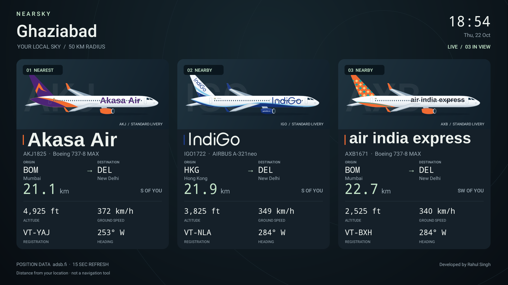
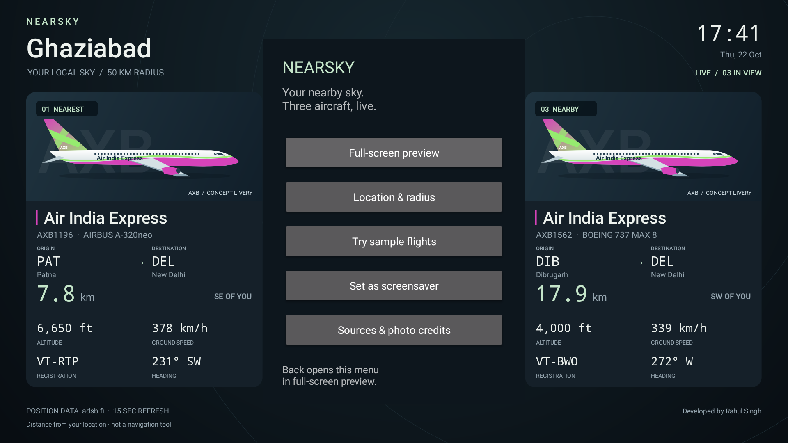
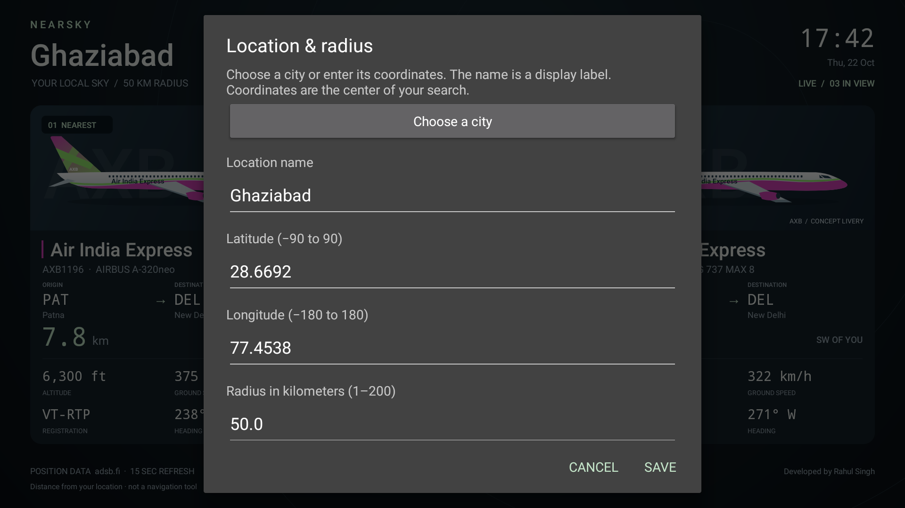
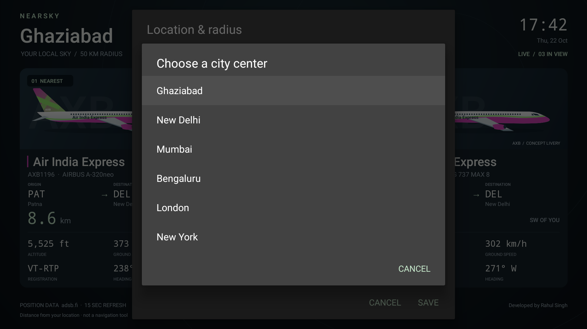
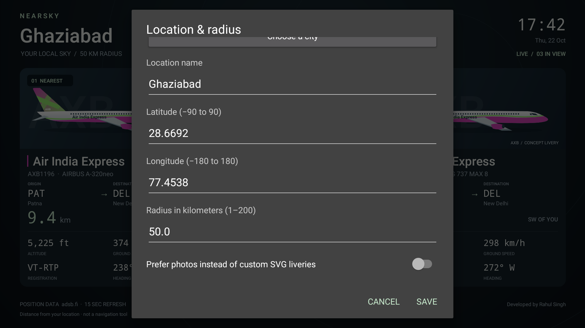

# NearSky for Android TV / Google TV

Developed by **Rahul Singh** · Current version: **1.4**

**[Step-by-step how-to guide](docs/HOW_TO.md)** — build from source, install on a TV, configure location and radius, enable the screensaver, customize liveries and troubleshoot.

A native Android screensaver showing up to three nearby airborne aircraft in three large cards across the full width of a horizontal TV. Defaults to **Ghaziabad (28.6692, 77.4538), within 50 km**. Android 8.0 or newer. No account, GPS permission, API key, backend or subscription required for the current personal-use data sources.

Each card shows a detailed SVG aircraft illustration with enlarged airline lettering and a larger outlined brand heading. **24 airlines have hand-redrawn standard-livery schemes**, including the approved IndiGo design, Air India, SpiceJet, Akasa Air, Air India Express, the major international carriers listed in the [livery catalogue](docs/LIVERIES.md), and UPS/FedEx cargo carriers. Other operator codes keep a labeled concept design. These are representative airline illustrations on a shared airliner silhouette, not exact fleet/type drawings or a guarantee of the paint currently on the reported aircraft. English wordmarks and simplified tail motifs are approximations, not official brand master assets.

Cards also show callsign, aircraft model, origin/destination airport codes with city names, registration, distance, direction from you, altitude, ground speed and heading. Optional reference photos matched to the aircraft hex identifier replace the SVG when available. With fewer than three aircraft in range, remaining slots show an empty state.

## Screenshots

Version 1.4 adds standard airline paint schemes and larger outlined names. **[See all 24 liveries](docs/LIVERIES.md)** or **[browse the TV screenshots](docs/SCREENSHOTS.md)** for settings, city presets, sample mode, photos and setup. Earlier settings captures remain from version 1.3.1.



| Main menu | Location and radius |
| --- | --- |
|  |  |

| City presets | Photo preference |
| --- | --- |
|  |  |

Live routes are provider reference data and may be outdated. The gallery labels sample mode separately and includes photo credits where applicable.

## Install

The supplied `NearSky-debug.apk` is a debug-signed, sideloadable build. It is not a Play Store release. Install it using a TV file-transfer application or ADB. On the TV, authorize installation from the file-transfer application if prompted.

With Android Platform Tools on your computer, enable Developer Options and the TV's ADB / wireless debugging option. Follow the TV's pairing instructions if it uses wireless pairing:

```sh
adb pair TV_IP:PAIRING_PORT
adb connect TV_IP:DEBUGGING_PORT
adb devices
adb install -r NearSky-debug.apk
adb shell am start -n com.nearsky.tv/.MainActivity
```

Older TVs may use `adb connect TV_IP:5555` without `adb pair`. Use the address/ports shown by your TV; pairing and debugging ports may differ. These commands assume one connected Android device; otherwise add `-s YOUR_TV_SERIAL` after `adb`.

## Configure and preview

1. Open **NearSky** from the TV's apps list.
2. Select **Location & radius**. Choose a city preset or enter a display name and coordinates. A display name alone does not look up a location. You can use your home's map-pin coordinates for greater accuracy than the default city center.
3. Leave the radius at 50 km or change it between 1 and 200 km. Save.
4. Select **Full-screen preview**. Press Back to return to the menu.
5. **Try sample flights** demonstrates the three-card layout. A prominent DEMO label remains visible. Sample mode only applies to the app preview; the actual screensaver always uses live positions.

The remote's directional pad and OK navigate settings. Menu opens location settings. Custom SVG liveries are the default. Turn on **Prefer photos instead of custom SVG liveries** only if you want reference photos. Version 1.1 starts with SVG mode on upgrade as well; the saved location and radius remain unchanged. The setup menu opens as a centered overlay. Full-screen preview and the screensaver use the entire landscape display without that menu.

## Select as the idle screensaver

Select **Set as screensaver**, then choose **NearSky · Nearby aircraft** in your TV's Screen saver / Ambient Mode settings and set the start delay. Some Google TV devices hide third-party screensaver selection. On these devices, the following shell settings may work; availability is controlled by the TV manufacturer and OS.

First record your current values so you can restore them:

```sh
adb shell settings get secure screensaver_components
adb shell settings get secure screensaver_default_component
adb shell settings get secure screensaver_enabled
adb shell settings get secure screensaver_activate_on_sleep
```

Then select NearSky:

```sh
adb shell settings put secure screensaver_components com.nearsky.tv/.FlightDreamService
adb shell settings put secure screensaver_default_component com.nearsky.tv/.FlightDreamService
adb shell settings put secure screensaver_enabled 1
adb shell settings put secure screensaver_activate_on_sleep 1
```

To restore the previous screensaver, repeat the `put` commands with the values you recorded. If a previous value was `null`, use `adb shell settings delete secure THE_SETTING_NAME` for that setting. The app itself does not change these system settings. Power / energy-saving settings may turn the TV off before the screensaver starts; set the TV's idle screensaver delay earlier than its power-off delay. Also turn off Developer Options → Stay awake if enabled. A fullscreen app preview stays awake intentionally; return to the launcher to test automatic idle activation.

For an immediate screensaver test on OS versions that offer it:

```sh
adb shell cmd dreams help
adb shell cmd dreams start-dreaming
adb shell cmd dreams stop-dreaming
```

If those shell commands are unavailable or return `Must be root`, use **Start now** / **Preview** in the TV's screensaver settings instead; root access is not needed to use the app. A normal remote key exits the screensaver. Reboots or manufacturer updates can reset third-party screensaver selection.

## Data behavior and privacy

- Default location is a Ghaziabad city-center approximation; edit it for your actual viewing position.
- Distance is horizontal great-circle distance to the aircraft's reported position, not slant distance or a prediction of its current position.
- Positions refresh 15 seconds after the previous request finishes. Network timeouts and failed requests can extend that interval. The feed is not guaranteed to be instantaneous.
- Grounded aircraft, invalid coordinates, duplicate identifiers and positions older than 60 seconds are excluded. Cached positions continue aging during an outage and disappear when too old. The app shows delayed / empty states instead of inserting sample flights.
- Aircraft reference photos and metadata load separately and are kept in a bounded memory cache. Photos are not requested while SVG mode is selected; aircraft metadata still supports model and operator lookup. They are never bundled into the APK. Image source URLs appear in **Sources & photo credits**.
- Location settings stay in private app preferences, excluded from Android backups. Coordinates are sent over HTTPS to adsb.fi for the nearby-aircraft query. Aircraft hex identifiers, flight callsigns and operator codes are sent to adsbdb; image requests go to Airport-data.com. Those services also receive your IP address. No analytics, GPS collection or background polling when the display stops.
- Route lookups use the exact reported callsign, including provider-returned ICAO/IATA aliases. Airport IATA codes are preferred, with ICAO codes as fallback; city names fall back to airport names. Missing coverage or lookup failures show Route unavailable. Routes are provider reference data, not verified real-time departure/arrival information, and may differ during diversions or callsign reuse. Results stay in a bounded memory cache for 30 minutes; unavailable results retry after 5 minutes while visible. Sample mode does not query routes for its fictional flights.
- Flights may lack callsigns, aircraft information or photos. No inferred origin/destination or airline is invented. Times follow the TV's configured clock and timezone.
- Dark colors and slight horizontal drift suit an ambient display; brightness and panel protection remain controlled by the TV. Not for aviation navigation.

## Build from source

Open this folder in Android Studio or use JDK 17 and an Android SDK with Platform 35 and Build Tools 36.0.0. Set `ANDROID_HOME` to the SDK path or create a private `local.properties` containing `sdk.dir=/your/android/sdk`.

```sh
./gradlew assembleDebug lintDebug assembleDebugAndroidTest
```

The APK is generated at `app/build/outputs/apk/debug/app-debug.apk`. The Gradle wrapper uses Gradle 8.11.1 and Android Gradle Plugin 8.9.1. This app uses native Android APIs and Java, with the bundled Apache-licensed AndroidSVG 1.4 library for SVG parsing and vector rendering. See `THIRD_PARTY.md`.

Run the dependency-free instrumentation checks on a connected emulator or TV:

```sh
adb install -r app/build/outputs/apk/debug/app-debug.apk
adb install -r app/build/outputs/apk/androidTest/debug/app-debug-androidTest.apk
adb shell am instrument -w com.nearsky.tv.test/com.nearsky.tv.SmokeInstrumentation
```

See `VALIDATION.md` for the checks actually performed and their limitations.

## Airline SVG liveries

Version 1.4 applies the approved IndiGo illustration style to **24 airlines**: IndiGo, Air India, SpiceJet, Akasa Air, Air India Express, British Airways, Lufthansa, Etihad, Qatar Airways, Singapore Airlines, Turkish Airlines, Emirates, Korean Air, UPS, FedEx Express, Air France, ANA, Japan Airlines, Saudia, Thai Airways, SriLankan Airlines, Oman Air, flydubai and Gulf Air.

- Airline colours, larger English lettering and simplified tail motifs follow representative standard schemes. Air India Express tail artwork varies; fleets may have transitional, leased or special paint. There is no per-registration livery matching.
- The approved IndiGo paths are preserved. Other English lettering is outlined using open-source Liberation fonts, with serif or sans-serif styling and selected italic/mixed-colour lettering. These are redrawn approximations; official wordmark master files and Arabic lettering are not supplied.
- `app/src/main/assets/liveries/CODE.svg` contains each editable 1200 × 440 transparent aircraft illustration. `wordmarks/CODE.svg` contains the corresponding scalable card heading. Outlines keep typography consistent across TVs without downloading fonts.
- `livery-catalogue.json` records airline identifiers, colours, references and limitations. [LIVERIES.md](docs/LIVERIES.md) lists the catalogue and regeneration instructions.
- Unknown codes retain a deterministic original concept illustration and the explicit CONCEPT LIVERY label. Registrations such as `N123AB` and `VT-ANB` are not interpreted as airline codes.
- Airline names for the 24 bundled carriers are available offline; exact-code adsbdb lookups extend metadata for other carriers. An aircraft's registered owner is never substituted for an airline name.
- The full `NearSky-SVG-liveries.zip` export includes all 17,576 AAA–ZZZ identifiers. The 24 bundled standard-livery illustrations override the generator; all other entries are concept artwork. This is code coverage, not a claim that all entries are real airlines or verified paint schemes.

Rebuild the bundled catalogue with Python 3 and JDK 17:

```sh
python3 tools/generate-liveries.py
```

Regenerate the full identifier pack:

```sh
./tools/export-liveries.sh /absolute/path/NearSky-SVG-liveries.zip
```

## Sources

- Live positions: [adsb.fi](https://adsb.fi), [open data API and personal/non-commercial use terms](https://github.com/adsbfi/opendata). Requests stay well below one per second. Review provider terms before distribution or commercial use.
- Routes, airline names, aircraft metadata and photo lookup: [adsbdb](https://www.adsbdb.com/), [API source and documentation](https://github.com/mrjackwills/adsbdb).
- Aircraft reference photographs: [Airport-data.com](https://www.airport-data.com/), copyright their respective photographers. Images remain remotely hosted; credits and individual image URLs are available in the app.
- Screensaver platform: Android [DreamService](https://developer.android.com/reference/android/service/dreams/DreamService).
- Aircraft illustrations: hand-redrawn representative standard schemes for 24 carriers plus original concept fallbacks. Airline names and marks remain the property of their owners; no airline endorsement is implied.

NearSky has been installed and opened on your TCL TV. Manufacturer-specific screensaver selection and idle behavior still need to be checked there.

Airline-name provenance and public brand spellings are recorded in `app/src/main/assets/airline-names-provenance.json`. Airline names are resolved by operator code, never by substituting the registered aircraft owner's name. Cached names share the app's backup exclusions.
