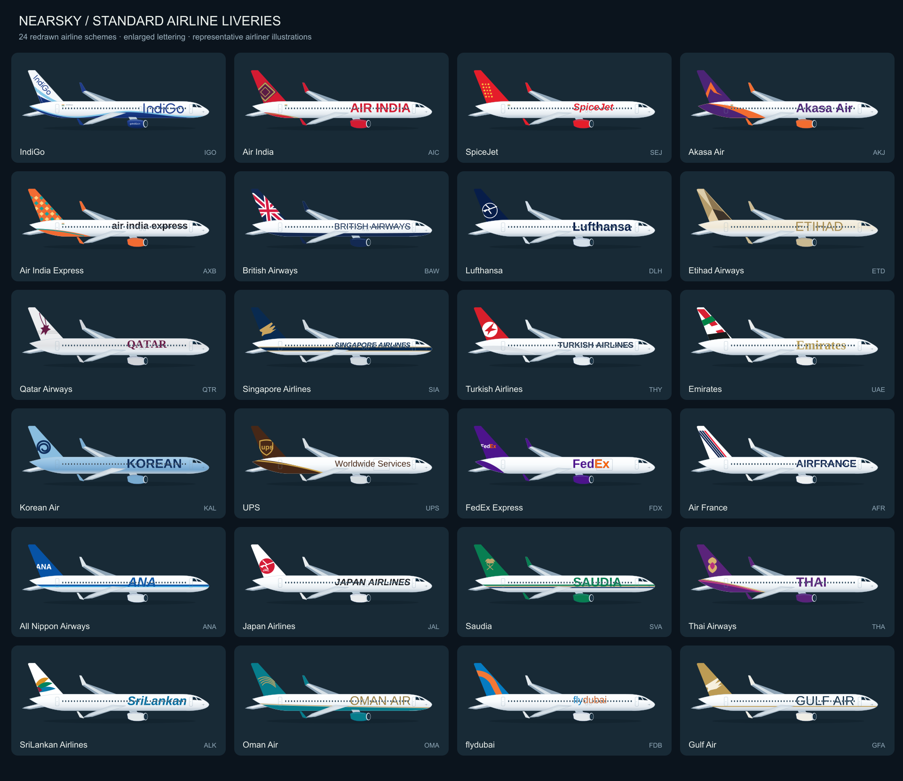

# Standard airline livery catalogue

NearSky 1.4 includes **24 hand-redrawn standard schemes**, following the approved IndiGo illustration style. All have larger English lettering on the fuselage. Version 1.4.1 uses a smaller, plain sans-serif airline name below each image; airline-style lettering stays on the aircraft.

The drawings use a shared representative airliner silhouette. They do not identify an aircraft's actual paint, exact aircraft type, transitional branding, wet lease or special scheme. English lettering and tail marks are simplified redraws, not official brand master files; Arabic lettering is not supplied. Air India Express tail textiles vary; one illustrative pattern is used. Korean Air uses the 2025 blue/KOREAN scheme. Lufthansa uses its standard white-body/deep-blue-tail scheme rather than the 2026 anniversary special.



| Code | Airline | Reference |
| --- | --- | --- |
| IGO | IndiGo | [Reference](https://www.airbus.com/en/newsroom/press-releases/2019-10-indigo-signs-for-300-a320neo-family-aircraft) |
| AIC | Air India | [Reference](https://www.airindia.com/in/en/newsroom/press-release/airbus-a350-inauguration-scindia.html) |
| SEJ | SpiceJet | [Reference](https://sg-images.spicejet.com/Magazine/SJ_April23.pdf) |
| AKJ | Akasa Air | [Reference](https://www.akasaair.com/) |
| AXB | Air India Express | [Reference](https://www.tata.com/newsroom/business/tales-of-india-air-india-express) |
| BAW | British Airways | [Reference](https://www.britishairways.com/) |
| DLH | Lufthansa | [Reference](https://newsroom.lufthansagroup.com/en/right-on-time-for-the-end-of-the-100th-crane-birthday-first-airbus-a380-in-new-lufthansa-design/) |
| ETD | Etihad Airways | [Reference](https://www.youtube.com/watch?v=fp01PXJ5UmE) |
| QTR | Qatar Airways | [Reference](https://www.qatarairways.com/en-au/press-releases/2006/Mar/aboutus_news_08march06.html) |
| SIA | Singapore Airlines | [Reference](https://www.singaporeair.com/) |
| THY | Turkish Airlines | [Reference](https://blog.turkishairlines.com/en/mesut-manioglu-pioneer-of-modern-graphic-design/) |
| UAE | Emirates | [Reference](https://www.emirates.com/media-centre/emirates-unveils-new-signature-livery-for-its-fleet/) |
| KAL | Korean Air | [Reference](https://news.koreanair.com/) |
| UPS | UPS | [Reference](https://about.ups.com/) |
| FDX | FedEx Express | [Reference](https://www.fedex.com/content/dam/fedex/eu-europe/resources/sprievodca-sluzbami-fedex.pdf) |
| AFR | Air France | [Reference](https://corporate.airfrance.com/) |
| ANA | All Nippon Airways | [Reference](https://www.ana.co.jp/eng/aboutana/press/2011/110622-1.html) |
| JAL | Japan Airlines | [Reference](https://press.jal.co.jp/en/release/201102/003357.html) |
| SVA | Saudia | [Reference](https://www.saudia.com/) |
| THA | Thai Airways | [Reference](https://www.thaiairways.com/static/common/pdf/royal_orchid_plus/Newletter/Newsletter_Apr-Jun2016_EN_lastest.pdf) |
| ALK | SriLankan Airlines | [Reference](https://www.srilankan.com/) |
| OMA | Oman Air | [Reference](https://www.omanair.com/) |
| FDB | flydubai | [Reference](https://www.flydubai.com/en/help/our-fleet/) |
| GFA | Gulf Air | [Reference](https://www.gulfair.com/) |

## Artwork files

`app/src/main/assets/liveries/CODE.svg`: editable transparent 1200 × 440 aircraft art. `app/src/main/assets/wordmarks/CODE.svg`: English brand outline references (not used for the live card names). `livery-catalogue.json`: identifiers, palette, references and limitations. There are no downloaded images, scripts, external fonts or runtime artwork requests in these assets.

Rebuild with Python 3 and JDK 17:

```sh
python3 tools/generate-liveries.py
```

The script uses the approved IndiGo SVG as its geometric template and the bundled open-source fonts under `tools/fonts/`. `OutlineLettering.java` converts the English lettering into paths. Font notices are retained in `THIRD_PARTY.md`, `tools/fonts/LICENSE.txt` and the app's `LICENSE-Liberation.txt` asset. The font files are build-time inputs and are not bundled in the APK.

Unknown codes retain labeled original concept artwork. The full 17,576-code export uses these 24 bundled overrides and concept fallbacks for every other identifier. Brand names and marks belong to their owners; no airline endorsement is implied.
