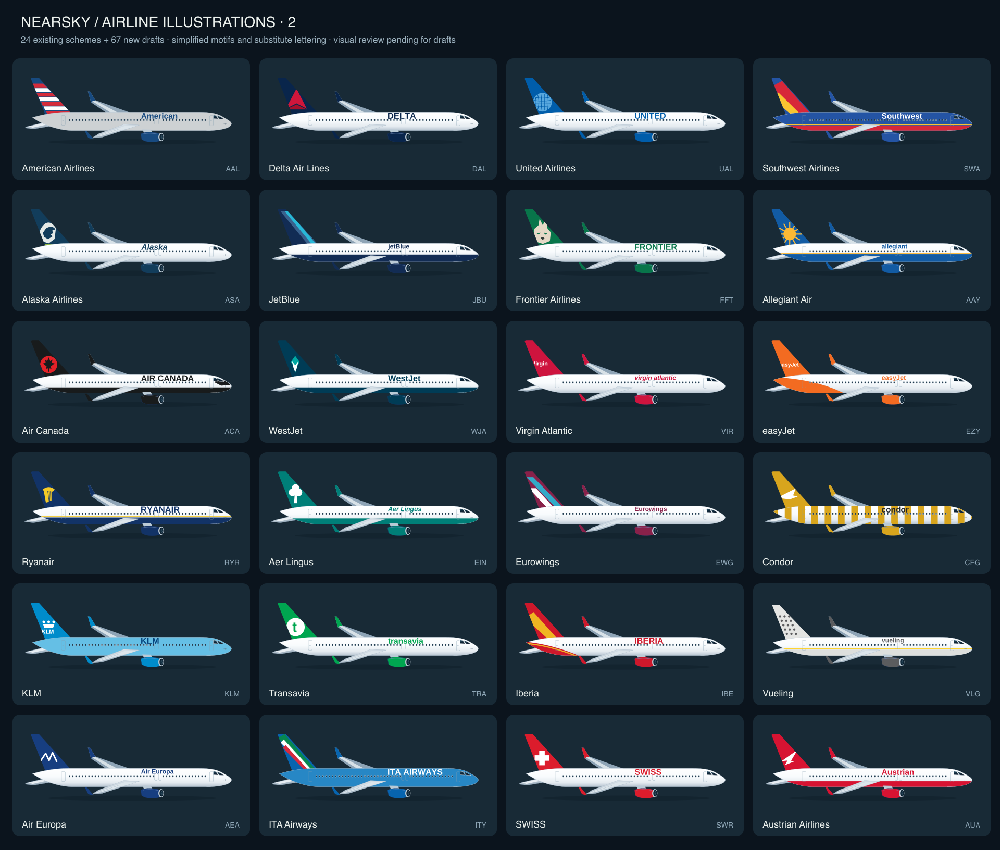
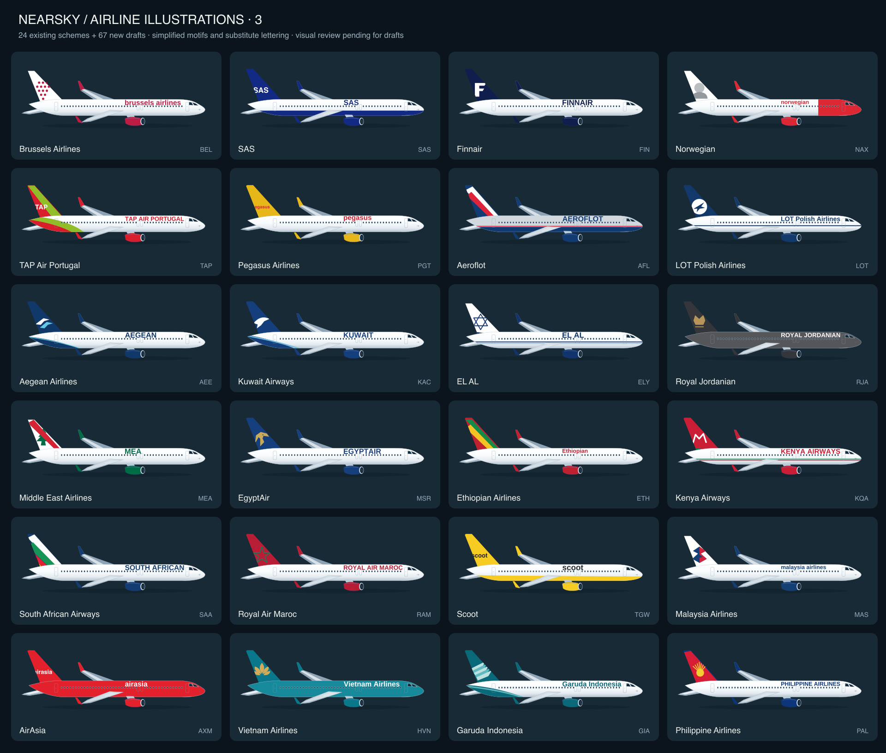
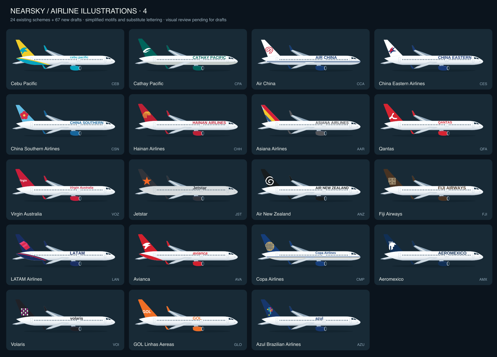

# Standard airline livery catalogue

NearSky 1.5.0 includes **91 bundled airline illustrations: 24 existing schemes and 67 new review drafts**, following the approved IndiGo illustration style. All have larger English lettering on the fuselage. Version 1.4.1 uses a smaller, plain sans-serif airline name below each image; airline-style lettering stays on the aircraft.

The drawings use a shared representative airliner silhouette. They do not identify an aircraft's actual paint, exact aircraft type, transitional branding, wet lease or special scheme. English lettering and tail marks are simplified redraws, not official brand master files; Arabic lettering is not supplied. Air India Express tail textiles vary; one illustrative pattern is used. Korean Air uses the 2025 blue/KOREAN scheme. Lufthansa uses its standard white-body/deep-blue-tail scheme rather than the 2026 anniversary special.


| Code | Airline | Reference |
| --- | --- | --- |
| IGO | IndiGo | [Reference](https://www.airbus.com/en/newsroom/press-releases/2019-10-indigo-signs-for-300-a320neo-family-aircraft) |
| AIC | Air India | [Reference](https://www.airindia.com/in/en/newsroom/press-release/airbus-a350-inauguration-scindia.html) |
| SEJ | SpiceJet | [Reference](https://sg-images.spicejet.com/Magazine/SJ_April23.pdf) |
| AKJ | Akasa Air | [Reference](https://www.akasaair.com/) |
| AXB | Air India Express | [Reference](https://www.tata.com/newsroom/business/tales-of-india-air-india-express) |
| BAW | British Airways | [Reference](https://www.britishairways.com/) |
| DLH | Lufthansa | [Reference](https://newsroom.lufthansagroup.com/en/right-on-time-for-the-end-of-the-100th-crane-birthday-first-airbus-a380-in-new-lufthansa-design/) |
| ETD | Etihad Airways | [Reference](https://www.youtube.com/watch?v=fp01PXJ5UmE) |
| QTR | Qatar Airways | [Reference](https://www.qatarairways.com/en-au/press-releases/2006/Mar/aboutus_news_08march06.html) |
| SIA | Singapore Airlines | [Reference](https://www.singaporeair.com/) |
| THY | Turkish Airlines | [Reference](https://blog.turkishairlines.com/en/mesut-manioglu-pioneer-of-modern-graphic-design/) |
| UAE | Emirates | [Reference](https://www.emirates.com/media-centre/emirates-unveils-new-signature-livery-for-its-fleet/) |
| KAL | Korean Air | [Reference](https://news.koreanair.com/) |
| UPS | UPS | [Reference](https://about.ups.com/) |
| FDX | FedEx Express | [Reference](https://www.fedex.com/content/dam/fedex/eu-europe/resources/sprievodca-sluzbami-fedex.pdf) |
| AFR | Air France | [Reference](https://corporate.airfrance.com/) |
| ANA | All Nippon Airways | [Reference](https://www.ana.co.jp/eng/aboutana/press/2011/110622-1.html) |
| JAL | Japan Airlines | [Reference](https://press.jal.co.jp/en/release/201102/003357.html) |
| SVA | Saudia | [Reference](https://www.saudia.com/) |
| THA | Thai Airways | [Reference](https://www.thaiairways.com/static/common/pdf/royal_orchid_plus/Newletter/Newsletter_Apr-Jun2016_EN_lastest.pdf) |
| ALK | SriLankan Airlines | [Reference](https://www.srilankan.com/) |
| OMA | Oman Air | [Reference](https://www.omanair.com/) |
| FDB | flydubai | [Reference](https://www.flydubai.com/en/help/our-fleet/) |
| GFA | Gulf Air | [Reference](https://www.gulfair.com/) |

## Artwork files

`app/src/main/assets/liveries/CODE.svg`: editable transparent 1200 × 440 aircraft art. `app/src/main/assets/wordmarks/CODE.svg`: English brand outline references (not used for the live card names). `livery-catalogue.json`: identifiers, palette, references and limitations. There are no downloaded images, scripts, external fonts or runtime artwork requests in these assets.

Rebuild with Python 3 and JDK 17:

```sh
python3 tools/generate-liveries.py
```

The script uses the approved IndiGo SVG as its geometric template and the bundled open-source fonts under `tools/fonts/`. `OutlineLettering.java` converts the English lettering into paths. Font notices are retained in `THIRD_PARTY.md`, `tools/fonts/LICENSE.txt` and the app's `LICENSE-Liberation.txt` asset. The font files are build-time inputs and are not bundled in the APK.

Unknown codes retain labeled original concept artwork. The full 17,576-code export uses 91 bundled overrides (including the 67 drafts) and concept fallbacks for every other identifier. Brand names and marks belong to their owners; no airline endorsement is implied.

## Real airline inventory and first expansion

[Full ICAO/IATA identity list](AIRLINES.md) · [Searchable offline gallery](AIRLINES.html) · [Sources and operating-status limits](../data/airlines/README.md). The first expansion excludes Spirit NKS and the Hawaiian HAL legacy operator code. The inventory preserves historical records and reused codes separately.

The **67 new designs are drafts**: each has an explicitly configured palette, fuselage paint and simplified tail motif rather than random code-based art. Current official imagery, complex logo shapes and substitute letterforms still need visual review and refinement. Norwegian uses a generic portrait silhouette rather than identifying a real tail portrait; Frontier uses a representative animal motif rather than matching a specific aircraft. Operator-only matching cannot distinguish regional subsidiaries, special paint or Hawaiian-painted ASA aircraft. These limitations are not silently counted as finished exact liveries.

| ICAO | Airline | Review status | Brand reference |
| --- | --- | --- | --- |
| AAL | American Airlines | Draft | [Reference](https://www.aa.com/) |
| DAL | Delta Air Lines | Draft | [Reference](https://news.delta.com/) |
| UAL | United Airlines | Draft | [Reference](https://www.united.com/) |
| SWA | Southwest Airlines | Draft | [Reference](https://www.southwest.com/) |
| ASA | Alaska Airlines | Draft | [Reference](https://news.alaskaair.com/) |
| JBU | JetBlue | Draft | [Reference](https://news.jetblue.com/) |
| FFT | Frontier Airlines | Draft | [Reference](https://news.flyfrontier.com/) |
| AAY | Allegiant Air | Draft | [Reference](https://www.allegiantair.com/) |
| ACA | Air Canada | Draft | [Reference](https://www.aircanada.com/) |
| WJA | WestJet | Draft | [Reference](https://www.westjet.com/) |
| VIR | Virgin Atlantic | Draft | [Reference](https://www.virginatlantic.com/) |
| EZY | easyJet | Draft | [Reference](https://www.easyjet.com/) |
| RYR | Ryanair | Draft | [Reference](https://www.ryanair.com/) |
| EIN | Aer Lingus | Draft | [Reference](https://www.aerlingus.com/) |
| EWG | Eurowings | Draft | [Reference](https://www.eurowings.com/) |
| CFG | Condor | Draft | [Reference](https://www.condor.com/) |
| KLM | KLM | Draft | [Reference](https://news.klm.com/) |
| TRA | Transavia | Draft | [Reference](https://www.transavia.com/) |
| IBE | Iberia | Draft | [Reference](https://www.iberia.com/) |
| VLG | Vueling | Draft | [Reference](https://www.vueling.com/) |
| AEA | Air Europa | Draft | [Reference](https://www.aireuropa.com/) |
| ITY | ITA Airways | Draft | [Reference](https://www.ita-airways.com/) |
| SWR | SWISS | Draft | [Reference](https://www.swiss.com/) |
| AUA | Austrian Airlines | Draft | [Reference](https://www.austrian.com/) |
| BEL | Brussels Airlines | Draft | [Reference](https://www.brusselsairlines.com/) |
| SAS | SAS | Draft | [Reference](https://www.sasgroup.net/) |
| FIN | Finnair | Draft | [Reference](https://www.finnair.com/) |
| NAX | Norwegian | Draft | [Reference](https://www.norwegian.com/) |
| TAP | TAP Air Portugal | Draft | [Reference](https://www.flytap.com/) |
| PGT | Pegasus Airlines | Draft | [Reference](https://www.flypgs.com/) |
| AFL | Aeroflot | Draft | [Reference](https://www.aeroflot.com/) |
| LOT | LOT Polish Airlines | Draft | [Reference](https://www.lot.com/) |
| AEE | Aegean Airlines | Draft | [Reference](https://en.about.aegeanair.com/) |
| KAC | Kuwait Airways | Draft | [Reference](https://www.kuwaitairways.com/) |
| ELY | EL AL | Draft | [Reference](https://www.elal.com/) |
| RJA | Royal Jordanian | Draft | [Reference](https://www.rj.com/) |
| MEA | Middle East Airlines | Draft | [Reference](https://www.mea.com.lb/) |
| MSR | EgyptAir | Draft | [Reference](https://www.egyptair.com/) |
| ETH | Ethiopian Airlines | Draft | [Reference](https://corporate.ethiopianairlines.com/) |
| KQA | Kenya Airways | Draft | [Reference](https://www.kenya-airways.com/) |
| SAA | South African Airways | Draft | [Reference](https://www.flysaa.com/) |
| RAM | Royal Air Maroc | Draft | [Reference](https://www.royalairmaroc.com/) |
| TGW | Scoot | Draft | [Reference](https://www.flyscoot.com/) |
| MAS | Malaysia Airlines | Draft | [Reference](https://www.malaysiaairlines.com/) |
| AXM | AirAsia | Draft | [Reference](https://newsroom.airasia.com/) |
| HVN | Vietnam Airlines | Draft | [Reference](https://www.vietnamairlines.com/content/dam/legacy-site-assets/FilesDownload/AboutUs/Corporate-Identity/GSM-2017-Web1.pdf) |
| GIA | Garuda Indonesia | Draft | [Reference](https://www.garuda-indonesia.com/) |
| PAL | Philippine Airlines | Draft | [Reference](https://www.philippineairlines.com/) |
| CEB | Cebu Pacific | Draft | [Reference](https://www.cebupacificair.com/) |
| CPA | Cathay Pacific | Draft | [Reference](https://www.cathaypacific.com/cx/en_MY/inspiration/cathay-stories/how-cathay-pacific-refreshed-its-aircraft-livery.html) |
| CCA | Air China | Draft | [Reference](https://www.airchina.com.cn/) |
| CES | China Eastern Airlines | Draft | [Reference](https://www.ceair.com/) |
| CSN | China Southern Airlines | Draft | [Reference](https://www.csair.com/) |
| CHH | Hainan Airlines | Draft | [Reference](https://www.hainanairlines.com/) |
| AAR | Asiana Airlines | Draft | [Reference](https://flyasiana.com/) |
| QFA | Qantas | Draft | [Reference](https://www.qantasnewsroom.com.au/) |
| VOZ | Virgin Australia | Draft | [Reference](https://newsroom.virginaustralia.com/) |
| JST | Jetstar | Draft | [Reference](https://www.jetstar.com/) |
| ANZ | Air New Zealand | Draft | [Reference](https://www.airnewzealand.co.nz/) |
| FJI | Fiji Airways | Draft | [Reference](https://www.fijiairways.com/) |
| LAN | LATAM Airlines | Draft | [Reference](https://www.latamairlines.com/) |
| AVA | Avianca | Draft | [Reference](https://www.avianca.com/) |
| CMP | Copa Airlines | Draft | [Reference](https://www.copaair.com/) |
| AMX | Aeromexico | Draft | [Reference](https://www.aeromexico.com/) |
| VOI | Volaris | Draft | [Reference](https://www.volaris.com/) |
| GLO | GOL Linhas Aereas | Draft | [Reference](https://www.voegol.com.br/) |
| AZU | Azul Brazilian Airlines | Draft | [Reference](https://www.voeazul.com.br/) |







The **real-code-only export** contains only the 91 bundled SVGs with per-design status in `catalogue.json`. Rebuild the offline HTML gallery, Markdown list, SVG sheets and pack with `python3 tools/build-airline-gallery.py` after generating artwork and the inventory. `tools/additional-liveries.py` contains the 67 new explicit design configurations. The remaining operating-status queue has no completed airline-specific artwork yet.
