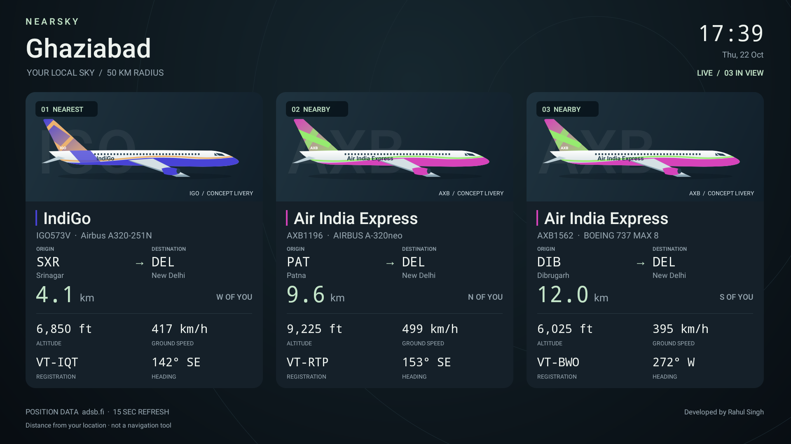
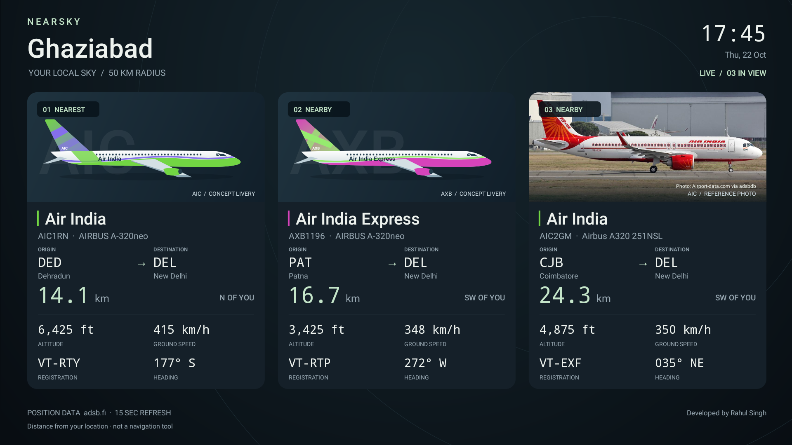
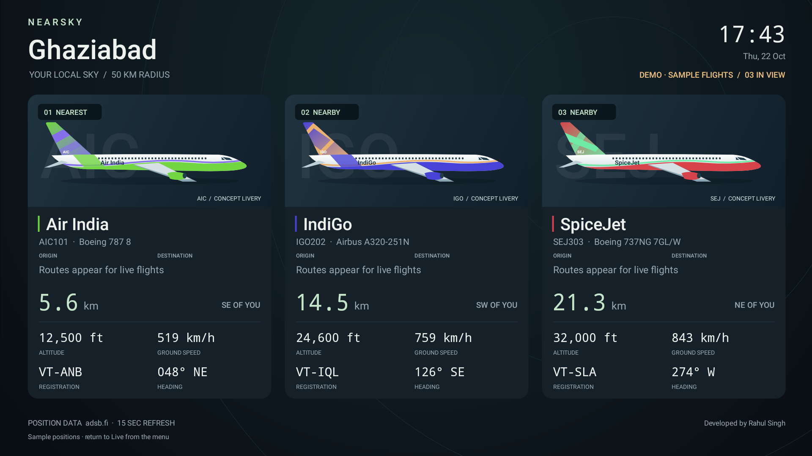
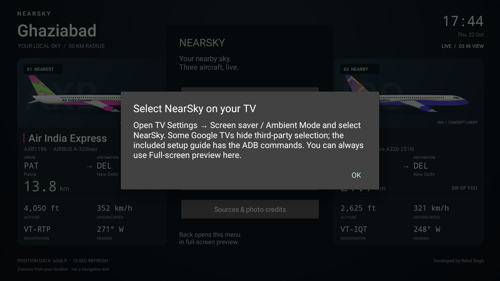
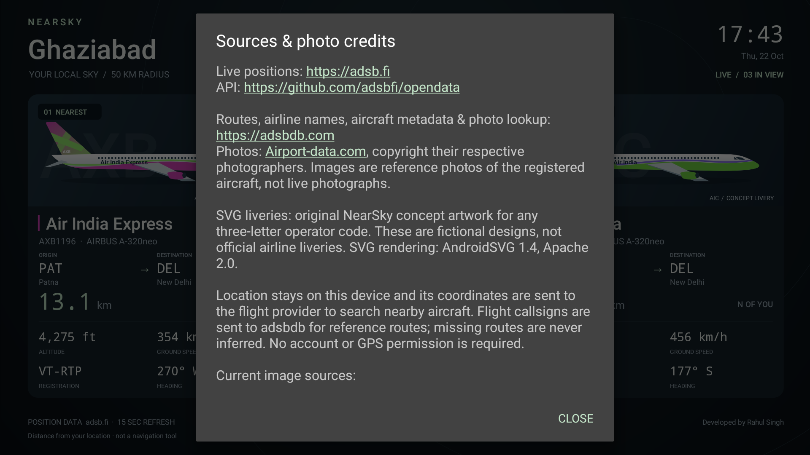

# NearSky screenshot gallery

Actual, unedited 1920 × 1080 captures of NearSky **1.3.1** on a TCL Android TV, taken on 22 October 2026. The live screens show real provider responses at capture time; routes are reference data and may be outdated. Sample flights are explicitly labeled DEMO. No mockup screens are included.

[Back to the README](../README.md) · [Build and setup guide](HOW_TO.md)

## Live screensaver

Actual system screensaver on a TCL TV, showing the three nearest airborne aircraft, airline names, original SVG liveries, origin/destination reference routes, distance, direction, altitude, speed, registration and heading. The local clock and developer credit are visible.

## Remote-friendly main menu

Access fullscreen preview, location and radius, sample flights, screensaver setup, and data-source credits.

## Location and radius settings

Change the display name, latitude, longitude and search radius. This capture uses the default Ghaziabad city-center coordinates and 50 km radius.

## City presets

Quickly choose Ghaziabad, New Delhi, Mumbai, Bengaluru, London or New York. Custom coordinates are available in the settings form.

## SVG or reference-photo preference

Scroll the location settings to switch between original SVG liveries and optional aircraft reference photographs.

## Reference photos with SVG fallback

Photo mode uses a reference photograph when one is available for the reported aircraft identifier and keeps SVG artwork for the other cards. The right-hand card shows a photo credited to Airport-data.com via adsbdb. Photos are not live images; copyright remains with their respective photographers.

## Clearly labeled sample mode

Three sample flights showcase different airline concept liveries. The DEMO indicator stays visible, and reference routes are not queried for the fictional sample flights.

## Screensaver setup guidance

This is the app’s fallback guidance on TCL firmware that does not expose the standard screensaver chooser. It is not a screenshot of the system chooser. The how-to guide explains the optional ADB selection method.

## Sources, credits and privacy information

View position, route, airline, aircraft metadata and photo providers, the original-artwork notice, and how location and identifiers are sent to the providers.

